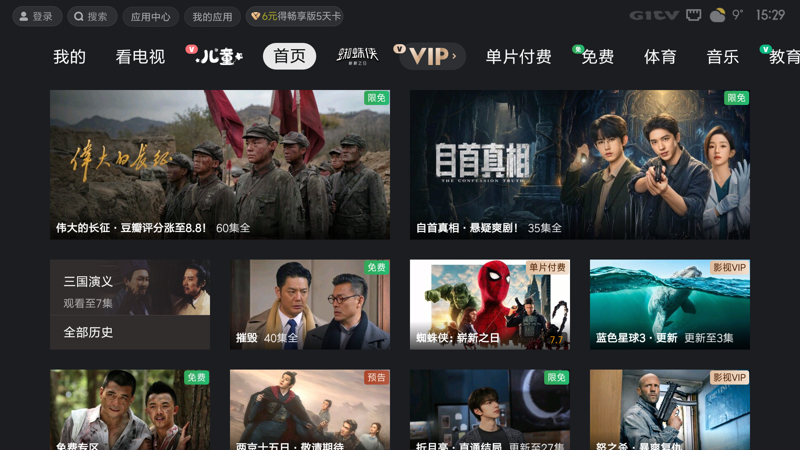
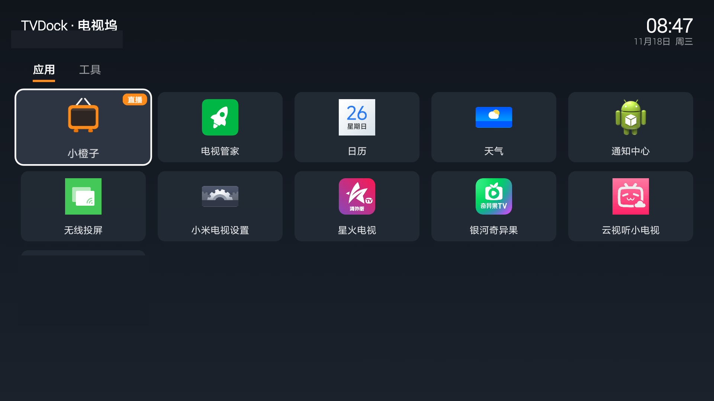
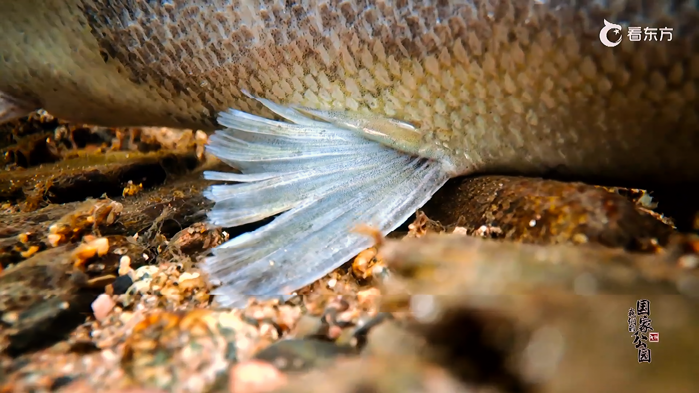

# TVDock · 小米电视优化套件

> **让每一台小米电视,回归"一台纯粹的电视"。**
> 开机 0 广告 · 首页 0 推荐 · 弹窗 0 骚扰 · 老电视满血复活


| 改造前:小米原生桌面 | 改造后:电视坞 TVDock |
|:---:|:---:|
| 满屏 VIP、单片付费、限免推荐 | 无广告、无推荐,开机直达应用网格 |
|  |  |

---

## 😤 你是否也被这样折磨

- 按下电源键,先看 **30 秒开机广告**
- 想看个直播,首页全是 **购物频道和游戏推荐**
- 看剧看到一半,弹出 **"您的系统可以升级了"**
- 追一集电视剧,先忍 **3 分钟贴片广告**
- 花大几千买的电视,用两年 **卡得像个机顶盒**
- 想装个干净点的直播应用,应用商店里 **没有,或全是套壳广告应用**

这个仓库,把上面的问题一次解决。

---

## 📦 这是什么

一套"**AI 替你动手**"的小米电视优化方案,三件各司其职:

| 组件 | 一句话定位 |
|---|---|
| **skill/** | 给 AI 看的优化技能书——AI 执行一切命令,你只负责回答"要哪个套餐" |
| **apk/tvdock-atv.apk** | 电视坞(TVDock):自研桌面,替代小米原生桌面,无广告、无推荐、纯应用网格 |
| **apk/xiaochengzi-tvlive.apk** | 小橙子:自研 IPTV 直播播放器,零内置源、支持 4K、专治老电视 |

---

## ✨ 四大亮点功能

### 1️⃣ 禁用广告

> **📊 实测数据(小米电视 3S 48")**
> 改造前:在银河奇异果追剧,**每 1 集夹约 3 分钟广告**
> 改造后:**连看 10 集,0 广告**——一次都没有出现

- 开机广告、首页推广、弹窗提醒、应用升级骚扰、观看记录上传——**13 项一键关闭**
- 两种套餐傻瓜选择:**温和优化**(只关广告)/ **极简安心**(连预装购物、游戏、推广应用一起收起)
- 只收起、不删除,**100% 可逆**;反悔时说一句"把电视恢复原状",一键全部找回
- 系统核心(播放框架、设置、遥控服务)绝不触碰,您自己装的应用一律不动

### 2️⃣ 全新的电视桌面

- **电视坞 TVDock**:自研桌面,无广告、无推荐位、无升级弹窗,开机直达应用网格
- 纯遥控器操作,焦点放大 + 描边,**老人也能一眼看清**
- 兼容 Android 4.4,老电视照跑不误
- 是否用它替换小米原生桌面,**由您拍板**(原生桌面可隐藏、也可随时换回)

### 3️⃣ 直播频道

- **小橙子**播放器:频道源由您自备(本地 U 盘 / 远程订阅均可),即插即用
- **4K 流畅播放**,源失效自动切换下一源,不用手动折腾
- 零内置源——应用里没有任何频道地址,加什么源看什么内容(合规红线)
- 双 UI:电视上遥控器操作,手机上触屏操作,自动适配
- 4K 直播实拍(电视录屏原画):

  

### 4️⃣ 全程 AI 辅助配置

- 对 AI 说一句 *"帮我优化电视"*,七步引导走完全程:开开关 → 找 IP → 选套餐 → 屏保 → 逐应用确认 → 执行 → **人话报告**
- 电视上要按哪些键、IP 在哪看,具体到按键次数,**手把手教**
- Windows **双击即用**、macOS/Linux 一行命令、**什么都不用装**
- adb 等小工具自动安装(Google 官方源 → 国内腾讯镜像自动回退)

---

## 📺 适用范围

**小米电视 / 小米盒子全系**(MIUI TV 各版本、Android TV 各版本),覆盖 **Android 4 及以上**的所有版本——包括 2013 年至今的老机型。

- ✅ 已实测:小米电视 3S 48"(MIUI TV 1.3.x / Android 4.4.4)全流程通过
- 📋 理论兼容:全系机型均可使用;不同系统版本的预装应用略有差异,但这不影响使用——套餐执行前会**扫描你电视上实际存在的应用**,按真实清单向你确认,绝不会瞎猜

---

## 🙌 需要您亲自参与的三件事

我们如实相告:有三件事,出于电视的权限与安全设计,必须由您亲手完成,AI 替不了:

| # | 事情 | 什么时候 | 要花多久 |
|---|---|---|---|
| ① | 打开电视的**开发者模式**和 **ADB 调试**两个开关 | 一次性(厂商权限门槛) | 约 1 分钟,AI 手把手引导 |
| ② | 安装应用时,在电视上按一次**"继续安装"**确认 | 每装一个应用时(安全设计如此) | 按一下遥控器(向导通常只需装 1~2 个应用) |
| ③ | 决定**是否把默认桌面换成电视坞** | 您拍板,AI 只引导、不擅自改 | 一次选择,原生桌面随时可换回 |

这三件之外的一切——扫描应用、执行命令、逐项验证、恢复回滚——全部由 AI 完成。

---

## 🚀 快速开始

**方式一:找 AI 代办(推荐,零门槛)**
> 对你的 AI 助手说:"帮我优化小米电视,用温和套餐"

**方式二:Windows 双击**
> 下载本仓库 → 双击 `skill\scripts\tv_wizard.bat` → 跟着提示按遥控器

**方式三:macOS / Linux 终端**
```bash
git clone https://github.com/hycore/tvdock.git
bash tvdock/skill/scripts/tv_wizard.sh
```

电视侧只需两步(向导会引导):开启**开发者模式**(设置→关于→产品型号上连按 OK 键 4 次)→ 开启 **ADB 调试**(账号与安全→ADB调试→允许)。

---

## 📁 目录结构

```
tvdock/
├── skill/                     # AI 优化技能书(必读:skill/SKILL.md)
│   ├── SKILL.md               # 第一原则 + 七步傻瓜对话流程
│   ├── docs/PACKAGES.md       # 预装包分类:绿色可冻结 / 黄色按需 / 红色绝不动
│   └── scripts/               # 双向导(sh / bat+ps1)、环境自检、回滚、保活等 12 个工具
└── apk/                       # 签名发布版
    ├── tvdock-atv.apk         # 电视坞桌面        v1.0.0
    └── xiaochengzi-tvlive.apk # 小橙子直播        v1.7.0
```

---

## 📋 应用版本

| 应用 | 包名 | 当前版本 | 系统要求 |
|---|---|---|---|
| 电视坞 TVDock | `com.tvdock.atv` | v1.0.0 | Android 4 以上(minSdk 19,实测 4.4) |
| 小橙子 | `com.xiaochengzi.tvlive` | v1.7.0 | Android 4 以上(minSdk 19,实测 4.4) |

---

## ⚖️ 合规声明

- 小橙子**不含任何直播源、频道地址或内容推荐**,仅为播放器;使用者自行配置的源,其内容合法性由使用者负责
- 本项目所有优化操作均为设备设置层面的"启用/停用",不破解、不刷机、不修改系统文件
- 关闭"系统自动升级"是为保护上述设置不被重置;老机型官方已停止更新,无功能损失,恢复模式可随时重新开启

## 📜 License

见 [LICENSE](LICENSE)
